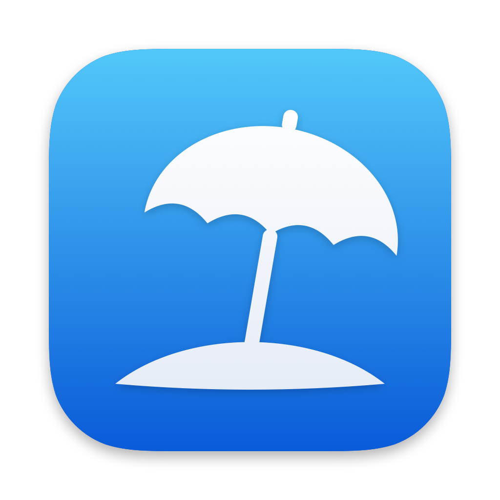
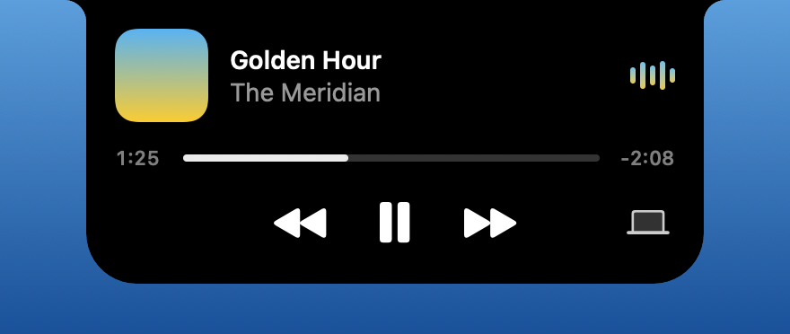
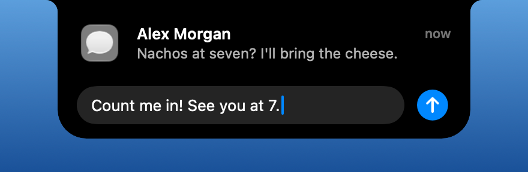
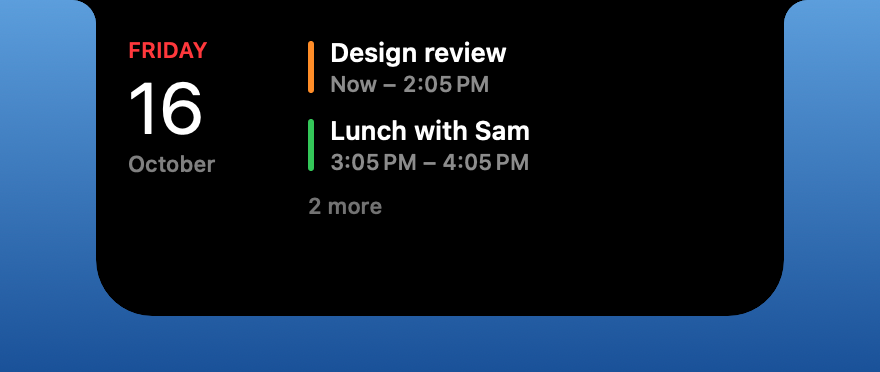
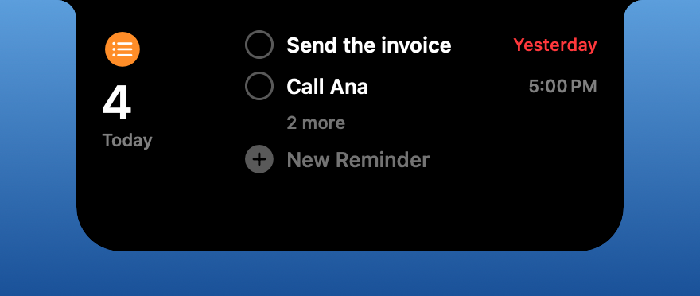
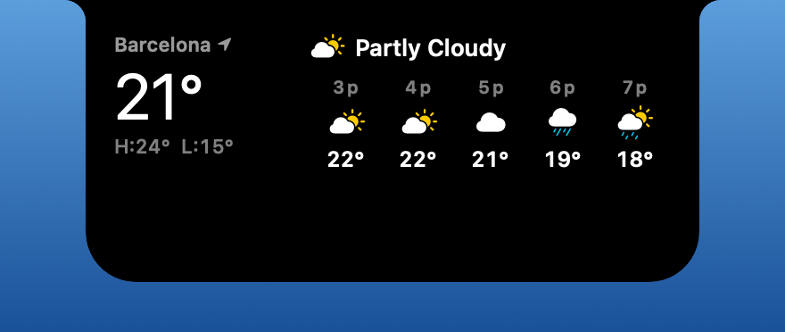
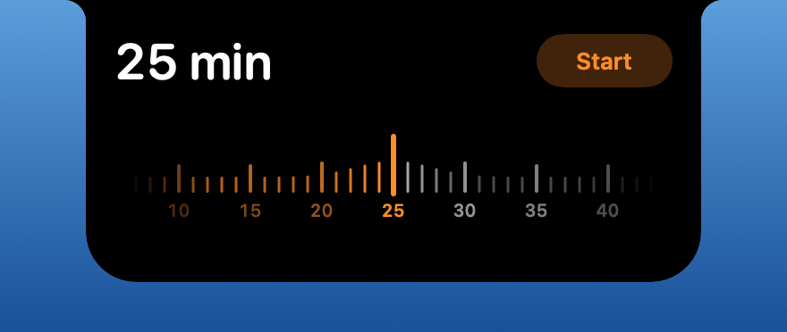
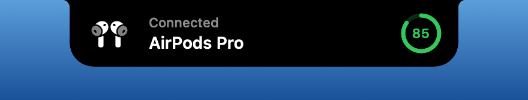
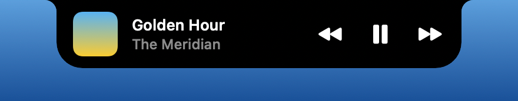
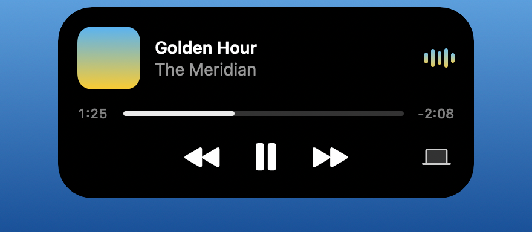

<p align="center"></p>

<h1 align="center">Shima</h1>
<p align="center"><b>島 — an island for your Mac's notch.</b><br>Free, open source, and made to feel like something Apple would ship.</p>

<p align="center">
  <a href="https://github.com/VendavalSC/Shima/releases/latest/download/Shima.dmg"><b>Download Shima</b></a> ·
  <a href="https://vendavalsc.github.io/Shima">Website</a> ·
  <a href="https://github.com/VendavalSC/Shima/releases">What's new</a>
</p>

<p align="center">
  
  
  
</p>

<p align="center"></p>

Shima turns the notch into a Dynamic Island. It shows what's playing, the notifications you get, your AirPods connecting, the coding agent you left working, and opens into a few pages you swipe through, without ever getting in the way. No account, no subscription, nothing to set up.

## Now Playing

Artwork, a waveform tinted with the colors of each cover, a scrubber, and a button to switch where the sound plays. Closed, the notch keeps the artwork and the waveform at its sides.

<p align="center"></p>

## Notifications you can answer

macOS's banner steps aside and the notification drops from the notch. Point at a chat (Messages, WhatsApp, Telegram…) and a reply box appears, so you can answer without leaving what you're doing. Swipe up with two fingers to send one away.

<p align="center"></p>

## Pages you swipe through

Open the notch and swipe with two fingers. Turn pages on or off and reorder them in Settings.

<table>
  <tr>
    <td width="50%"><br><b>Calendar</b> — what's left of today.</td>
    <td width="50%"><br><b>Reminders</b> — tick them off, or type "Call Ana tomorrow at 5".</td>
  </tr>
  <tr>
    <td><br><b>Weather</b> — now and the next five hours.</td>
    <td><br><b>Timer</b> — slide the ruler, press Start.</td>
  </tr>
</table>

There's also **System** (CPU, memory, disk and battery) and a **Shelf**: drag files to the notch to keep them for later, or to AirDrop them.

## Live activities

Small things worth knowing, shown for a moment and then gone.

<table>
  <tr>
    <td width="50%"><br><b>AirPods</b> — with Apple's own spinning model and the battery.</td>
    <td width="50%"><br><b>Touch ID</b> — whenever anything asks for your finger.</td>
  </tr>
  <tr>
    <td><br><b>Coding agents</b> — Claude Code or Codex at work, when one needs you, and when it's done.</td>
    <td><br><b>Lock screen</b> — music controls, and a fingerprint beside the padlock.</td>
  </tr>
</table>

Also: charging and low battery, Caps Lock, Focus, your next calendar event, and drives (with an Eject button).

## Notch or island

Hang from the top edge like the notch, or float like iPhone's Dynamic Island. Choose per display, on every display, and watch one turn into the other.

<p align="center"></p>

## Install

1. Download [**Shima.dmg**](https://github.com/VendavalSC/Shima/releases/latest/download/Shima.dmg), open it, and drag Shima to Applications.
2. Shima isn't notarized yet, so the first time, right-click it → **Open** → **Open**. Or run:

```bash
xattr -dr com.apple.quarantine /Applications/Shima.app
```

Updates are one click: choose **Check for Updates…** from the parasol in the menu bar.

Shima needs macOS 15 Sequoia or later, and works with or without a camera notch.

## Permissions

All optional. Shima asks only when you turn on something that needs it.

| Feature | Permission |
|---|---|
| Notifications, replies, Caps Lock | Accessibility |
| Focus changes | Full Disk Access |
| Calendar page and Up Next | Calendars |
| Reminders page | Reminders |
| Weather where you are | Location (or pick a city instead) |

To show coding agents, press **Connect** next to Claude Code or Codex in Settings → Activities. That adds a small hook to their settings; **Disconnect** takes it out again.

## Privacy

Nothing leaves your Mac, with one exception: when the Weather page is on, a rounded location goes to [Open-Meteo](https://open-meteo.com) to get the forecast. It's off by default. Idle, Shima uses about 0% CPU.

## Build it yourself

Only the Command Line Tools are needed, no Xcode:

```bash
./build.sh && open build/Shima.app
```

To keep permissions across rebuilds, create a self-signed **Code Signing** certificate named `Shima Development` in Keychain Access (or put another name in `.signing-identity`).

## License

[GPL-3.0](LICENSE). Free, and it stays free.
